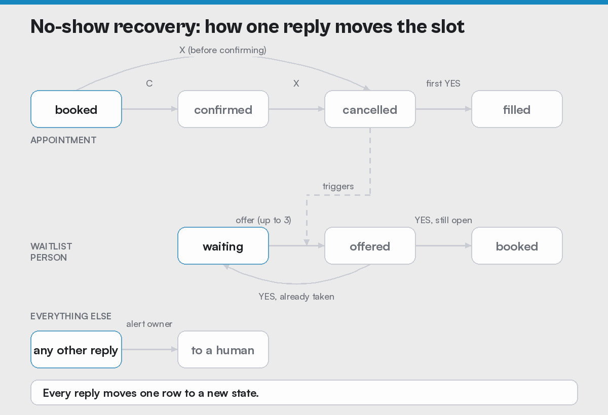

# No-Show Recovery (n8n + Twilio WhatsApp + Google Sheets)

When a patient cancels, this workflow automatically offers the slot to the waitlist. It also gives the clinic owner a log showing what each recovered slot was worth.



Built in public by [Ezekiel Adoh](https://www.prolificanalytics.io) as Demo Drop 2 of the Build With Me series. Import it, connect your own accounts, and test it from your phone in about 30 minutes.

## What it does

| Patient sends | What happens |
|---|---|
| nothing (48 h and 24 h before) | Two WhatsApp reminders, "Reply C to confirm or X to cancel", while the appointment is still `booked`. Each one is sent exactly once. |
| `C` | Appointment becomes `confirmed`. |
| `X` | Appointment becomes `cancelled`, and the open slot goes to up to 3 waitlist people at once, earliest sign-up first. |
| `YES` (first) | Slot becomes `filled`. The log records it as `recovered` with its dollar value. |
| `YES` (anyone after) | "Sorry, that spot was just taken." They go back to `waiting`, so there's no double booking. |
| anything else | The patient gets "someone from the office will reply shortly." The owner gets the exact text, logged as `needs_human`. |

Replies like `c.`, ` x ` or `Yes!` work too. The Normalize step trims spaces, ignores capitalization and removes trailing punctuation.

## Results from the live test

These are real WhatsApp messages from a phone to the live webhook, on Oct 19, 2026. The \$180 is an illustrative demo value per appointment.

| Message | Path | Run time |
|---|---|---|
| `C` | confirm | 12.8 s |
| `X` | cancel, then 2 offers | 20.2 s (offers logged about 18 s after the X) |
| `YES` | slot still open, so claimed | 12.4 s |
| `YES` | slot already taken, so turned down | 12.4 s |
| "Can I come in at 3?" | to a human | 5.5 s |

**Summary tab after the test:** 1 slot recovered, \$180, 1 sent to a human. A 24-hour reminder was then sent once, and the next two checks, one manual and one on the live schedule, sent nothing.

Most of the run time is Google Sheets API round trips. With a real database, the same flow should drop to a few seconds (an estimate, not measured).

## What's in the repo

```
workflow/dd2-no-show-recovery.json   the n8n workflow (37 nodes, inactive on import)
sheet-template/*.csv                 the 4 tabs: appointments, waitlist, log, summary
assets/dd2-state-diagram.gif         the diagram above (PNG version too)
```

## Setup

You need an n8n account (Cloud or self-hosted), a Twilio account, and a Google account.

### 1. Create the Google Sheet

1. Create a new Google Sheet with 4 tabs named exactly `appointments`, `waitlist`, `log` and `summary`.
2. Import each CSV from `sheet-template/` into its tab: File → Import → Upload → Replace current sheet.
3. Replace `+1XXXXXXXXXX` with your own phone number in international format. Type a `'` before it (`'+15551234567`) so Sheets keeps the `+`.
4. Set `start_time` in `appointments` to a time 24–48 hours from now, with your UTC offset, for example `2026-10-20T15:00:00-07:00`.
5. Copy the Sheet ID from its URL: the long string between `/d/` and `/edit`.

`summary` uses three formulas:

```
=COUNTIF(log!B:B,"recovered")
=SUMIF(log!B:B,"recovered",log!F:F)
=COUNTIF(log!B:B,"needs_human")
```

### 2. Import the workflow

1. Open `workflow/dd2-no-show-recovery.json` in a text editor. Find and replace every `YOUR_GOOGLE_SHEET_ID` with your Sheet ID, and the one `+1XXXXXXXXXX` (owner alerts, in the Unclear: alert node) with your phone.
2. In n8n, create a new workflow, then use ⋯ → Import from File.
3. The Sheets and Twilio nodes show a red warning until you connect credentials. That's expected.

### 3. Connect credentials

- **Google Sheets:** add an OAuth2 credential and select it in every Sheets node.
- **Twilio:** add your Account SID and Auth Token, and select the credential in every Twilio node. Never paste these into a node field or commit them anywhere.

### 4. Point Twilio at the workflow

1. In the Twilio Console, go to Messaging → Try it out → Send a WhatsApp message. Join the sandbox from your phone by sending the `join <code>` message it shows you.
2. In n8n, open the Webhook node and copy the Production URL (it ends in `/webhook/dd2-reply`).
3. In Twilio's Sandbox settings, paste that URL into "When a message comes in", choose method POST, and save.
4. The workflow sends from the sandbox number `+14155238886`. If you use your own approved sender, change "From" in every Twilio node.

### 5. Publish

Click Publish in n8n. Saving changes only the draft. The live webhook runs the last published version, so publish again after every edit.

## Test script

Reset first: set `appointments` `status` to `booked` and clear `filled_by`. Set both `waitlist` rows to `waiting`, with `offered_appt_id` empty. Clear the `log` contents below the header, using clear contents, not delete rows. Then, from your phone, one message at a time:

1. `C` → confirmed reply. `status` = `confirmed`.
2. `X` → cancel reply, plus 2 offers. `status` = `cancelled`, and both waitlist rows are `offered`.
3. `YES` → "You're booked". `status` = `filled`, and the log has `recovered` with `180`.
4. `YES` → "just taken". The second waitlist row goes back to `waiting`.
5. `can I come at 3?` → the office reply, plus an owner alert. The log has `needs_human`.

Pass: `summary` reads 1 / 180 / 1.

The test uses one phone for every row, so it can play the patient, the waitlist and the owner. With real patients, each person's reply matches their own row.

## What broke while building it

1. **The first live test ran an old version.** The live webhook used the last published version, and every fix had only been saved to the draft. Fix: publish. This is the gap between staging and production.
2. **A cleared field didn't clear.** In n8n's Sheets Update node, an empty field means "leave this column alone". So a lost offer left a stale `offered_appt_id` on the row. Fix: write an explicit `none`.
3. **The 24-hour reminder would have repeated every 15 minutes.** Mark sent always stamped `r48_sent`, and the sheet had no `r24_sent` column, so the 24-hour reminder never looked sent. Fix: each reminder stamps its own column. Proof: running the check twice in a row sends once.
4. **`C.` didn't match `C`.** Patients add punctuation, so Normalize removes it before matching.

## Before using this with real patients

This is a demo. A client deployment needs:

| Demo | Production |
|---|---|
| Google Sheets (no row locking) | A database. The claim becomes one update that only succeeds if the slot is still open (`UPDATE ... WHERE status = 'cancelled'`, then check that 1 row changed), so two YES messages in the same second can't both win. |
| WhatsApp sandbox, one phone | An approved WhatsApp sender with approved message templates, or A2P 10DLC-registered SMS, plus STOP and HELP handling and recorded consent. |
| Owner alert to one number | A shared inbox or on-call rotation, so `needs_human` doesn't depend on one person's phone. |
| No health data rules | For healthcare: a signed BAA with every vendor that touches patient data, only the minimum necessary information in messages (no diagnoses or procedure details), and consent records. |
| Manual testing | Automated tests for each path, including "run the reminder check twice, assert 1 message". |

## Want it set up for your practice?

The free template is this repo. For a version wired into your scheduler, with SMS, consent handling and reporting, see [Prolific Analytics](https://www.prolificanalytics.io).

## License

MIT. Use it, change it, ship it. Keep your own credentials out of your fork.
